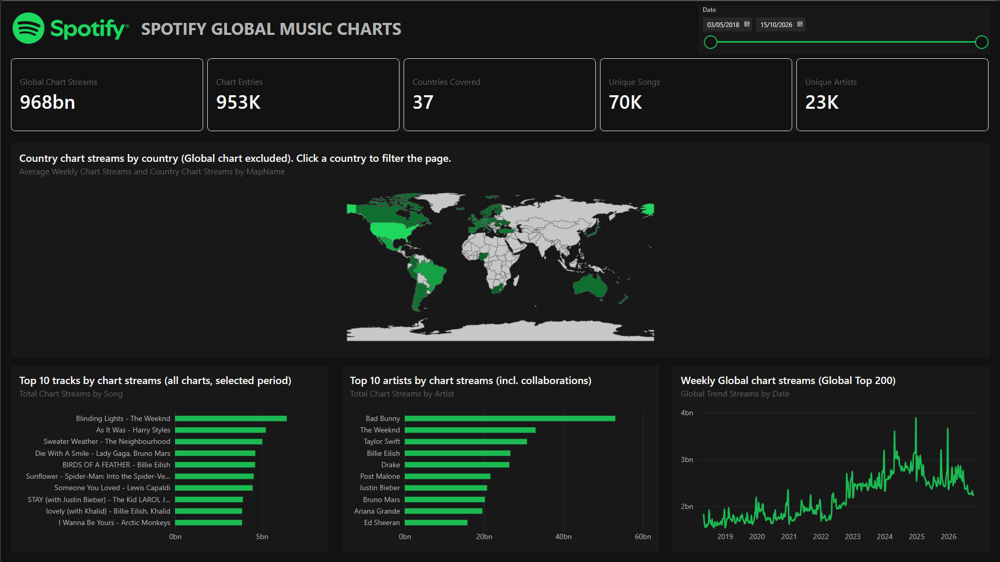
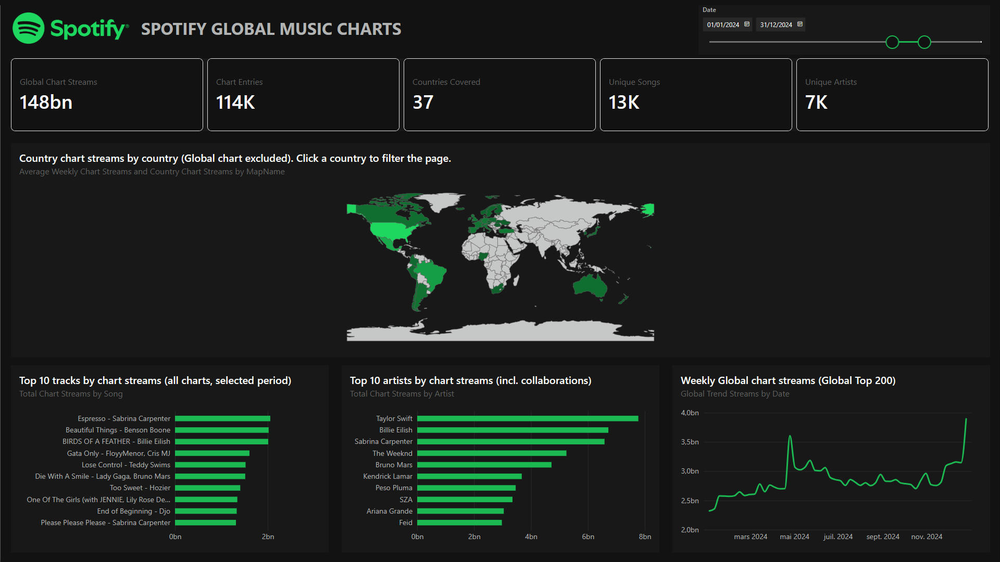
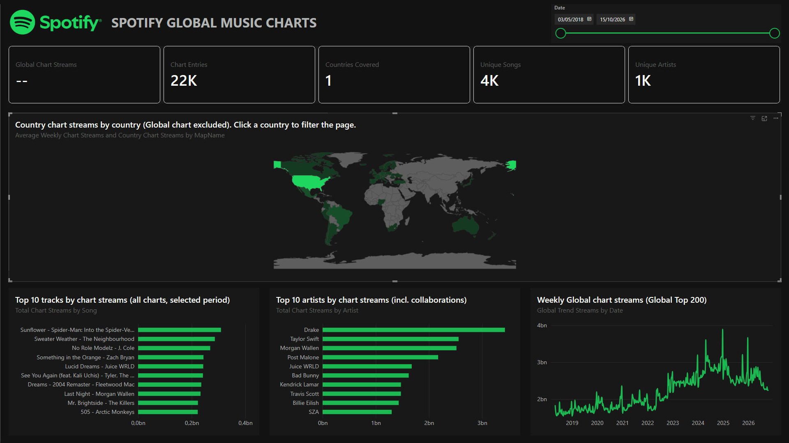
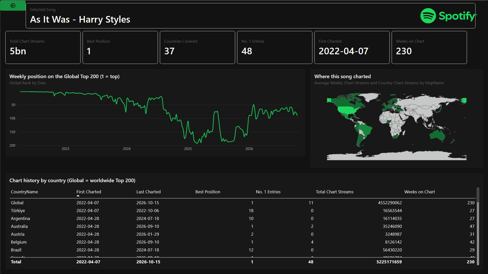
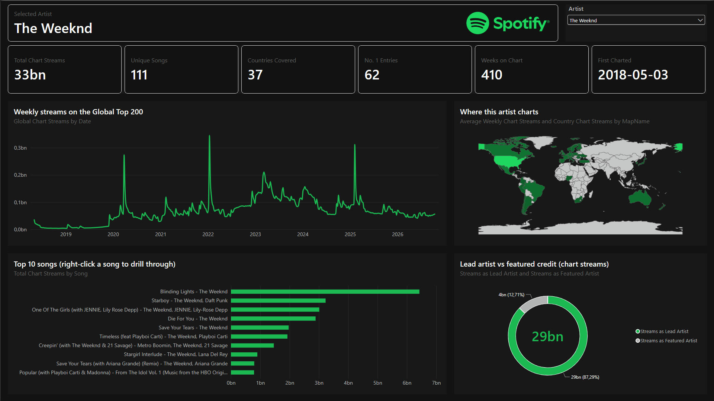
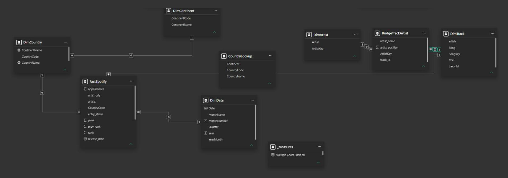

# Spotify Global Music Charts: Power BI Dashboard

An interactive Power BI report built on **953,000 weekly Spotify Top 200 chart entries** (May 2018 – October 2026) across **37 country charts and the Global chart**. It answers where music is streamed, which songs and artists dominate, and how a single hit spreads around the world.



## Highlights

- **3 report pages:** an Overview, a Track deep-dive reached by drill-through, and an Artist profile.
- **A star schema with an artist bridge table**, so collaborations are credited to each artist instead of being counted as one "artist" text value.
- **Fair comparisons:** countries are compared on average weekly streams because their chart coverage differs, and duplicate track IDs are merged into one song.
- **An offline world map** (Shape Map + TopoJSON) because Azure Maps was blocked by the organisation's tenant settings.
- **27 DAX measures**, the dataset's coverage issues documented, and validation checks included.

| | |
|---|---|
| **Tools** | Power BI Desktop · Power Query (M) · DAX · TMDL view · DAX query view |
| **Data** | 9 yearly CSV files · 953K rows · 81,010 track IDs → 69,883 songs · 22,800 artists |
| **Period** | 2018-05-03 → 2026-10-15 (442 chart weeks) |

---

## The report

### 1. Overview

KPI cards, a world map, the top 10 songs and artists, and the weekly Global streams trend. Every visual cross-filters the others, and a date slicer controls the whole page.


**Filter by date:** narrowing the slicer to 2024 updates every visual. *Espresso* by Sabrina Carpenter becomes the top song, and Taylor Swift becomes the top artist.



**Filter by country:** clicking the US on the map filters the cards, top songs and top artists to the US chart, where Drake is the top artist. The Global streams trend is designed to stay visible as context.



### 2. Track deep-dive (drill-through)

Right-click any song and choose **Drill through → Track deep-dive** to see one song's chart life:

- its streams, best position, number of countries, No. 1 entries, first chart date and weeks on the chart
- its weekly position on the Global Top 200, with #1 at the top of the axis
- where it charted
- a table by country, sorted by first chart date, showing where the song broke first.

*As It Was* by Harry Styles had 5bn chart streams, charted in 37 countries, had 48 No. 1 entries and spent 230 weeks on the chart.



### 3. Artist profile

Pick any of the 22,800 artists from a searchable dropdown. The page shows their streams over time, their reach, their top 10 songs (each can be drilled through to its track page), and how much of their streams come from songs where they are the lead artist versus a featured credit.

The Weeknd had 33bn chart streams from 111 songs, and 87% of those streams came from songs where he is the lead artist.



### Tested interactions

| Interaction | Result |
|---|---|
| Date slicer set to 2024 | Every visual updates: 148bn Global streams, 13K songs, 7K artists |
| Click a country (US) on the map | The cards and top 10 lists filter to the US. The Global card shows "--" because the Global chart isn't a country |
| Right-click a song → Drill through | Opens the Track deep-dive for that song |
| Back button (Ctrl+click in Desktop) | Returns to the page you came from |
| Artist dropdown | The whole Artist profile page updates |

---

## Key findings

Full tables are in [`documentation/business-insights.md`](documentation/business-insights.md).

1. **The US, Mexico and Brazil stream the most per week.** On raw totals Türkiye looks like the #2 market, but that's only because it has 4× more chart weeks than most countries. On a weekly average it ranks 7th.
2. **Bad Bunny is the biggest charting artist** with 42.5bn Global chart streams, followed by The Weeknd, Taylor Swift, Billie Eilish and Drake.
3. ***Die With A Smile* spent the most weeks at #1 on the Global chart (30).** Its run is split across two Spotify track IDs (21 + 9 weeks), so counting by track ID alone would understate it.
4. **Global Top 200 streams grew about 64% from 2019 to 2024**, then dipped about 8% in 2025.
5. ***Blinding Lights* is the longest-charting song**, with 2,235 chart entries across all 37 countries.
6. **Songs still in the chart fall about 18 places a week on average**, as new releases push them down.

---

## Data model



| Table | Role |
|---|---|
| `FactSpotify` | One row per song per chart per week (rank, previous rank, streams, track, artists) |
| `DimDate` | Calendar built in Power Query and marked as the date table. MonthName is sorted by MonthNumber |
| `DimCountry` / `DimContinent` | 38 chart codes (37 countries + `GLOBAL`), with names, continents and a `MapName` field that matches the map's country spellings |
| `DimTrack` | One row per track ID, with a `SongKey` (title + artists) that merges duplicate releases |
| `BridgeTrackArtist` / `DimArtist` | Splits the `artists` and `artist_uris` columns into one row per track per artist (134,005 rows → 22,800 artists) |
| `_Measures` | All DAX measures (`Measures` is a reserved name in Power BI) |

All relationships are one-to-many with single-direction filtering. The one exception is `DimTrack → BridgeTrackArtist`, which filters both ways so that selecting an artist reaches the fact table.

### Key DAX measures

```dax
Average Weekly Chart Streams =
DIVIDE ( [Total Chart Streams], DISTINCTCOUNT ( FactSpotify[week_end] ) )

Unique Artists =
CALCULATE (
    DISTINCTCOUNT ( BridgeTrackArtist[ArtistKey] ),
    CROSSFILTER ( FactSpotify[track_id], DimTrack[track_id], Both )
)

Global Trend Streams =      -- ignores country selections, keeps date filters
CALCULATE (
    [Total Chart Streams],
    REMOVEFILTERS ( DimCountry ),
    DimCountry[CountryCode] = "GLOBAL"
)

Average Rank Improvement =
AVERAGEX (
    FILTER ( FactSpotify, NOT ISBLANK ( FactSpotify[prev_rank] ) ),
    FactSpotify[prev_rank] - FactSpotify[rank]
)
```

The full list of measures is in the [data dictionary](documentation/data-dictionary.md).

---

## Data preparation

1. **Combined** the nine yearly CSV files into `FactSpotify` and set data types.
2. **Built the country dimensions** from a country-code lookup. `GLOBAL` is kept as its own row and is never plotted on the map.
3. **Fixed labels:** the continent "America" was renamed to "South America".
4. **Merged duplicate songs:** about 14% of track IDs are re-releases of the same song, which `DimTrack[SongKey]` merges.
5. **Split artists** into a bridge table so that every collaborator gets credit for a song.
6. **Validated the data:**
   - country codes are unique and every fact row matches one
   - every chart has exactly 200 rows per week
   - the 13,450 rows with a missing `release_date` are left blank, not filled in.

### Known limitations

- **Uneven coverage:** the Global chart and Türkiye have all 442 weeks, but the other 36 countries have only 111. Country comparisons use weekly averages for this reason.
- **Overlapping charts:** Global and country chart streams count some of the same plays, so they must never be added together. Country totals are chart streams, not unique worldwide streams.
- **Collaboration credit:** every credited artist gets a collaboration's full streams, so artist totals add up to more than the grand total.
- **Map needs internet:** the map loads its country shapes from a public TopoJSON file, so Power BI needs a connection to draw it.

---

## How to open the report

1. Install [Power BI Desktop](https://powerbi.microsoft.com/desktop/) (Windows).
2. Get the source CSV files (see [`data/README.md`](data/README.md)). The raw data isn't committed to this repository.
3. Open `powerbi/Spotify_Global_Music_Intelligence.pbix`.
4. If the data path differs, go to **Transform data → Data source settings**, point it at your local folder, then click **Refresh**.
5. Optional: apply the theme with **View → Themes → Browse for themes → `powerbi/SpotifyDarkTheme.json`**.

## Repository structure

```text
spotify-global-music-intelligence/
├── powerbi/
│   ├── Spotify_Global_Music_Intelligence.pbix
│   └── SpotifyDarkTheme.json
├── screenshots/
│   ├── overview.png
│   ├── date-filter-2024.png
│   ├── country-filter-us.png
│   ├── track-deep-dive.png
│   ├── artist-profile.png
│   └── data-model.png
├── documentation/
│   ├── business-insights.md
│   └── data-dictionary.md
├── data/
│   └── README.md
└── README.md
```

## Data source

- **Dataset:** _add the dataset name, author and link_
- **Licence:** _add the licence / terms of use_

---

> Spotify and the Spotify logo are trademarks of Spotify AB. This is an independent portfolio project, not affiliated with or endorsed by Spotify.
